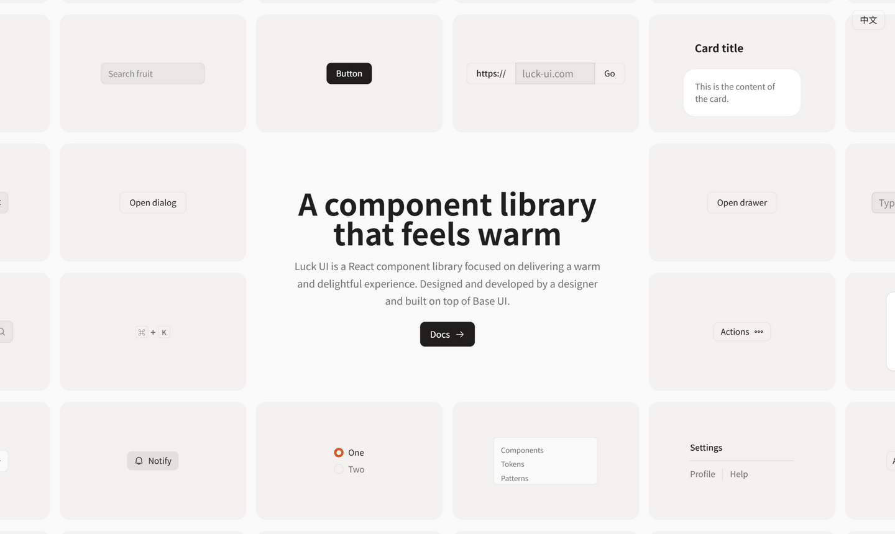
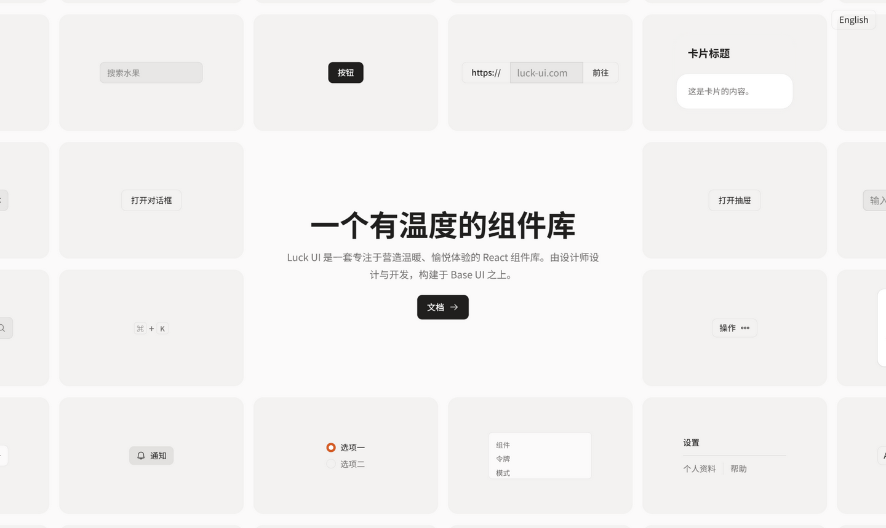
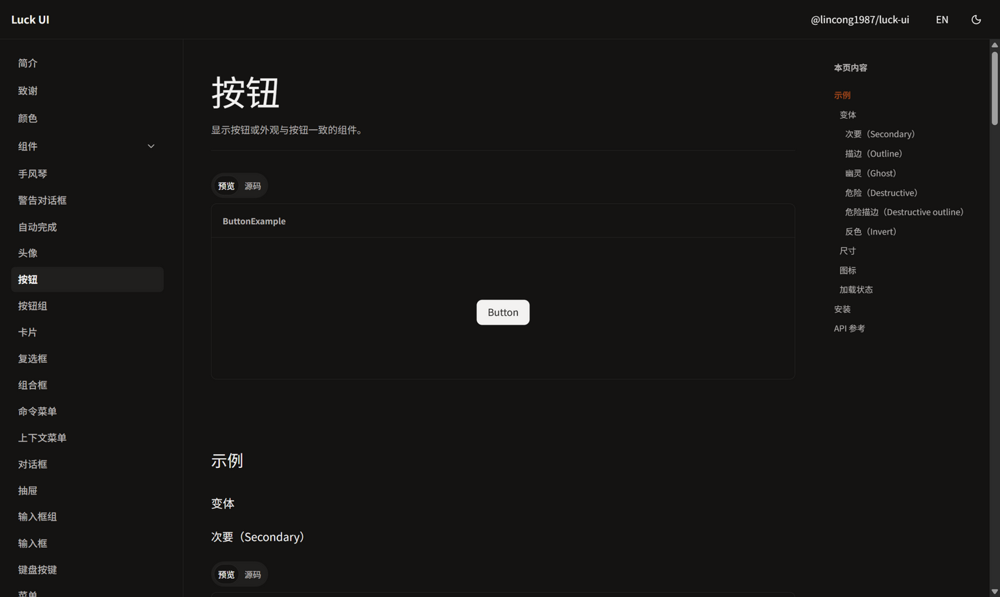
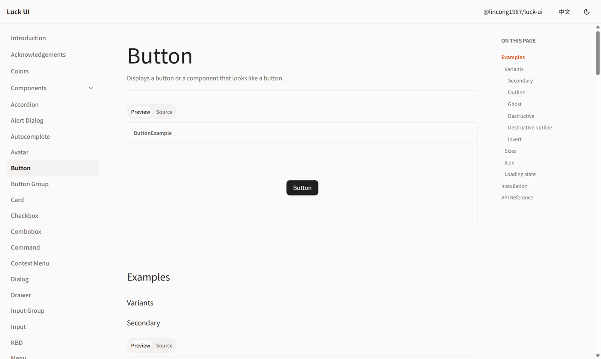
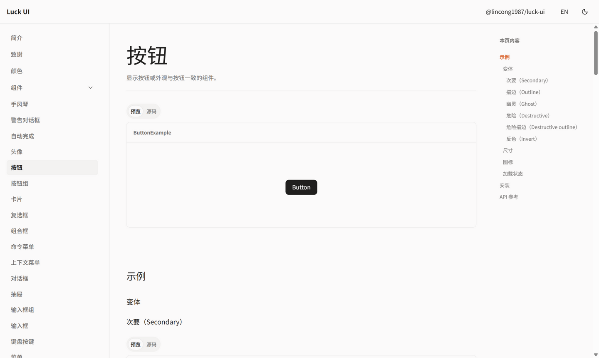

<div align="center">

# Luck UI

**A warm, bilingual React component library — built on Base UI, styled with Tailwind CSS v4, distributed through the shadcn registry.**

[](https://lincong1987.github.io/luck-ui/)
[](./LICENSE)
[](https://react.dev)
[](https://tailwindcss.com)
[](https://lincong1987.github.io/luck-ui/docs)
[](https://lincong1987.github.io/luck-ui/zh/docs)

[English](https://lincong1987.github.io/luck-ui/docs) · [简体中文](https://lincong1987.github.io/luck-ui/zh/docs) · [Report Bug](https://github.com/lincong1987/luck-ui/issues) · [Request Feature](https://github.com/lincong1987/luck-ui/issues)



</div>

## ✨ Why Luck UI?

Luck UI gives you **31 accessible components with 135 live examples** in a warm, human design language — warm grays, orange accents, generous rounded corners, and subtle micro-interactions. It is made for consumer-facing products that should feel inviting, not for dense data dashboards.

Like [shadcn/ui](https://ui.shadcn.com), Luck UI is **not an npm dependency**. It is a copy-paste registry: you own the code. Every component is a single self-contained file with no hidden abstractions and no version lock-in.

|                              |                                                                                   |
| ---------------------------- | --------------------------------------------------------------------------------- |
| ♿ **Accessible by default** | Built on [Base UI](https://base-ui.com)'s unstyled, WAI-ARIA-compliant primitives |
| 🌗 **Light & dark modes**    | Theme defined entirely with CSS variables; flip `data-theme="dark"`               |
| 🌏 **Bilingual docs**        | Full documentation in English and 简体中文 with a path-preserving switch          |
| 🎬 **Motion built in**       | Smooth, natural transitions via [Motion](https://motion.dev)                      |
| 🧩 **Own your code**         | Self-contained files you copy in and customize freely                             |
| 🎨 **Warm design language**  | Warm gray + orange OKLCH palette, large radii, human feel                         |

<details>
<summary><strong>📦 31 components</strong></summary>

Accordion · Alert Dialog · Autocomplete · Avatar · Button · Button Group · Card · Checkbox · Combobox · Command · Context Menu · Dialog · Drawer · Input · Input Group · Kbd · Menu · Number Field · Popover · Radio · Scroll Area · Select · Separator · Slider · Switch · Tabs · Tag · Textarea · Toast · Toggle · Tooltip

</details>

## 🌅 Screenshots

<div align="center">
 
</div>
<div align="center">
 
</div>

## 🚀 Getting Started

### 1. Set up your project

Luck UI components expect **React 19 + Tailwind CSS v4** with the Base UI primitives installed:

```bash
pnpm add @base-ui/react @phosphor-icons/react motion
```

### 2. Add a component

Pull any component straight from the registry with the shadcn CLI:

```bash
npx shadcn@latest add https://raw.githubusercontent.com/lincong1987/luck-ui/main/public/r/button.json
```

Browse every registry item in [`public/r/`](./public/r) — each component, demo, and the theme are one JSON away:

```bash
npx shadcn@latest add https://raw.githubusercontent.com/lincong1987/luck-ui/main/public/r/dialog.json
npx shadcn@latest add https://raw.githubusercontent.com/lincong1987/luck-ui/main/public/r/toast.json
npx shadcn@latest add https://raw.githubusercontent.com/lincong1987/luck-ui/main/public/r/theme.json   # the color tokens
```

### 3. Own the code

The component source lands in your project. Restyle it, rename it, delete half of it — it's yours.

## 🖥 Local Development

```bash
git clone https://github.com/lincong1987/luck-ui.git
cd luck-ui
pnpm install
pnpm dev
```

| Command               | Description                                    |
| --------------------- | ---------------------------------------------- |
| `pnpm dev`            | Start the docs site at `http://localhost:3000` |
| `pnpm build`          | Production build                               |
| `pnpm typecheck`      | Type-check with `tsc --noEmit`                 |
| `pnpm lint`           | Lint with oxlint                               |
| `pnpm registry:build` | Rebuild registry JSON into `public/r/`         |
| `pnpm typegen`        | Regenerate fumadocs MDX types                  |

**Deploy targets.** The site is a [TanStack Start](https://tanstack.com/start) app. Build for Cloudflare Workers with plain `pnpm build` + `pnpm deploy`, or for any static host (GitHub Pages) with:

```bash
VITE_BASE_PATH=luck-ui VITE_STATIC_BUILD=true VITE_SITE_URL=https://lincong1987.github.io/luck-ui pnpm build
# deploy dist/client
```

## 🧱 Tech Stack

- **[TanStack Start](https://tanstack.com/start)** — full-stack React framework with file-based routing and static prerendering
- **[React 19](https://react.dev)** + TypeScript
- **[Base UI](https://base-ui.com)** — accessible component primitives
- **[Tailwind CSS v4](https://tailwindcss.com)** — theme via CSS variables, no config file
- **[fumadocs-mdx](https://fumadocs.dev)** — MDX-powered bilingual documentation
- **[Motion](https://motion.dev)** — transitions and micro-interactions

## 🤝 Contributing

Contributions are welcome! To add a component:

1. Create it in `registry/default/ui/<component>.tsx` with demos in `registry/default/examples/`
2. Register it in `registry.json` and run `pnpm registry:build`
3. Add both English and Chinese docs under `content/docs/` and `content/docs-zh/`

Please open an issue first for larger changes.

## 📄 License

[MIT](./LICENSE) — free for personal and commercial use.

## 🙏 Acknowledgements

Luck UI stands on the shoulders of:

- [Base UI](https://base-ui.com) — accessible React primitives powering every component
- [shadcn/ui](https://ui.shadcn.com) — the copy-and-paste registry model and CLI tooling
- [Coss UI](https://coss.com/ui) — design and styling inspiration

<div align="center">
<sub>If Luck UI made your day a little luckier, consider giving it a ⭐</sub>
</div>
